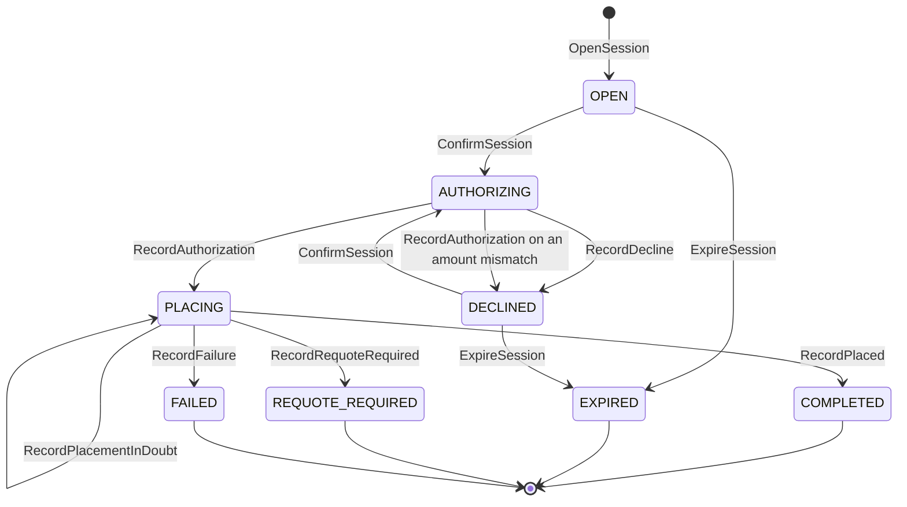

# Aggregate Design Canvas

Following the ddd-crew [Aggregate Design Canvas v1.1](https://github.com/ddd-crew/aggregate-design-canvas).
The context has one aggregate root, **CheckoutSession**, and no read models.
Go packages: `internal/domain/checkoutsession` (plus `shared`).

## CheckoutSession

### 1. Name

`CheckoutSession` (`checkoutsession.CheckoutSession`), identified by `sessionId`.

### 2. Description

The purchase transaction from review to placed order. It holds the cart id
and version, the `shopperId`, the `shipToAddressId` (never the address), the
numbered lines and groups, the `priceQuoteId`, the totals and
`quoteExpiresAt`, the `authorizationId`, the stored placement request, the
`orderId`, the `requotedOffers`, a failure code, `authAttempt` (starts at 0,
incremented on each `DECLINED → AUTHORIZING`), the pending payment token (kept
only while `AUTHORIZING`) and `voidOwed` (the `authorizationId`, set in the same
transaction as the decision to void).
Value objects:

| Value object | Fields | Note |
| --- | --- | --- |
| `Line` | `lineNo`, `catalogItemId`, `quantity` | The session numbers the cart's lines `1..n` when it opens. |
| `Group` | `groupNo`, `offerId`, `tier`, `lineNos[]`, `amountMinor` | Groups follow the quote's `groupNo`; `amountMinor` is the share of the quote total (the **Allocation**: items + delivery charge + pro-rata tax, summing exactly to the total). |
| `RequotedOffer` | `offerId`, `groupNo`, `tier`, `deliverByEarliest`, `deliverByLatest`, `expiresAt` | One offer the network returned in a definitive `409`; present only in `REQUOTE_REQUIRED`. |
| `StoredPlacement` | `requestBody`, `requestHash` (SHA-256), `placingSince` | The PII-free placement request replayed byte for byte; `placingSince` drives the 20 h alert; purged 24 h after a terminal state. |

The **stored placement request** is the `StoredPlacement` value object, part
of the aggregate's state: the PII-free body the Anti-Corruption Layer sends to
`customer-ordering`, kept so that `ResolveInDoubtPlacements` can re-send it
byte for byte with the same `Idempotency-Key`.

### 3. State Transitions

Source: `internal/domain/checkoutsession/session.go` (states and the doc comment
of the transitions), `transitions.go` and `terminals.go` (the commands).

The entry arrow `[*] --> OPEN` is the creating command `OpenSession`. Four
states are terminal: `COMPLETED`, `EXPIRED`, `REQUOTE_REQUIRED` and `FAILED`
(`ErrSessionClosed`). `PLACING` is the semantic lock (no void and no new
attempt while the place-order outcome is unknown) and `DECLINED` accepts
another token while the price quote is valid. The only loops are `DECLINED → AUTHORIZING` (a new
token) and `PLACING → PLACING` (an in-doubt outcome that stays in doubt).
`DECLINED → EXPIRED` (`ExpireSession`) is implemented, as
`ExpireOnQuoteExpiry` says. A session stuck in
`AUTHORIZING` is settled by `ResolveStuckAuthorizations`, not by a state of
its own.

### 4. Enforced Invariants

| Invariant | Enforced by |
| --- | --- |
| The cart's checkout readiness holds at session open | `OpenSession` → `ErrCartNotCheckoutReady` |
| The price quote is unexpired at confirm | `ConfirmSession` → `ErrPriceQuoteExpired` (`422 price-quote-expired`) |
| No transition out of `COMPLETED`, `EXPIRED`, `FAILED` or `REQUOTE_REQUIRED` | all commands → `ErrSessionClosed` |
| Every selected offer is still `QUOTED` and expires more than 2 minutes from now at open; no state change, the BFF refreshes the cart quote (`REQUOTE_REQUIRED` stays a `PLACING`-time `409` only) | `OpenSession` → `ErrOfferNotQuotable` (`422 offer-not-quotable`) |
| The groups partition the lines and the allocations sum to the quote total | `OpenSession` → `ErrContractViolation` (`502 upstream-contract-violation`) |
| A new confirm is refused while a void is still owed | `ConfirmSession` → `ErrVoidPending` (`409 void-pending`) |
| The authorized amount and currency equal the quote's | `RecordAuthorization` → `ErrAuthorizationMismatch` (the session returns to `DECLINED` with the void owed) |
| No void and no new attempt while the place-order outcome is unknown (the semantic lock) | `ConfirmSession` and the void step in `PLACING` → `ErrPlacementInDoubt` |

Source: `internal/domain/checkoutsession/open.go`, `allocate.go`, `transitions.go`,
`terminals.go`; the error-to-problem mapping is `internal/adapters/inbound/http/errors.go`
(`409` on open: `cart-not-checkout-ready`; `409` on confirm: `session-closed`,
`authorization-mismatch`, `placement-in-doubt`, `void-pending`, `illegal-transition`;
`422`: `price-quote-expired`, `offer-not-quotable`, `validation-failed`).

### 5. Corrective Policies

| Policy | Owner | Rule | Effect on this aggregate |
| --- | --- | --- | --- |
| `ResolveInDoubtPlacements` | this context | Re-send the stored placement body with the same `Idempotency-Key` (`customer-ordering` replays the first response) with backoff until a definitive answer; alert at 20 h (from `placingSince`); give up and void at 22 h; customer-payments' own 24 h void of an unbound authorization is the backstop. | A `PLACING` session reaches `COMPLETED` (`RecordPlaced`), `REQUOTE_REQUIRED` (`RecordRequoteRequired`) or `FAILED` (`RecordFailure`), or stays `PLACING` (`RecordPlacementInDoubt`). |
| `ResolveStuckAuthorizations` | this context | A session in `AUTHORIZING` for more than 2 minutes re-calls `AuthorizePayment` with the same key, which is idempotent and yields the true outcome; `customer-payments`' 24 h void stays the backstop. | `AUTHORIZING` reaches `PLACING` (`RecordAuthorization`) or `DECLINED` (`RecordDecline`). |
| `RetryOwedVoids` | this context | Every minute, until success, void the authorization named by `voidOwed` (covers `ErrAuthorizationMismatch` and every definitive-rejection void); `Void` is idempotent. | Clears `voidOwed`; no state change. |
| `PurgeStoredPlacements` | this context | Drop the stored placement request 24 h after a closed state. | Clears `placement`; no state change, no event. |
| `ExpireOnQuoteExpiry` | this context | An `OPEN` or `DECLINED` session expires with its price quote. | `OPEN → EXPIRED` and `DECLINED → EXPIRED` (`ExpireSession`). |
| Idempotent writes | this context | Every write route takes an `Idempotency-Key`; a repeated key returns the stored response of the first call. | A repeated `ConfirmSession` with the same key does not authorize twice. |
| Deterministic downstream keys | this context | `<sessionId>:auth:<authAttempt>` on authorize (a new attempt after a decline, the same key for a stuck call), `<sessionId>:void` on void, the `sessionId` on place-order. | No two holds on a card for one session; a replayed place-order is answered with the first response. |

### 6. Handled Commands

| Command | Trigger | Transition |
| --- | --- | --- |
| `OpenSession` | Shopper via BFF, REST `POST /checkout-sessions` (reads the cart, pre-checks offers, issues the `PriceQuote`) | `[*] → OPEN` |
| `ConfirmSession` | Shopper via BFF, REST `POST /checkout-sessions/{sessionId}:confirm` | `OPEN → AUTHORIZING`; `DECLINED → AUTHORIZING` (increments `authAttempt`) |
| `RecordAuthorization` | the answer to `AuthorizePayment` (authorized) | `AUTHORIZING → PLACING`; on an amount or currency mismatch `AUTHORIZING → DECLINED` with `voidOwed` |
| `RecordDecline` | the answer to `AuthorizePayment` (declined) | `AUTHORIZING → DECLINED` |
| `RecordPlacementInDoubt` | `PlaceOrder` timed out or answered `503`; also each unsuccessful pass of `ResolveInDoubtPlacements` | `PLACING → PLACING` (raises `CheckoutPlacementInDoubt` on the first pass only) |
| `RecordPlaced` | `PlaceOrder` succeeded (first call or replay) | `PLACING → COMPLETED` |
| `RecordRequoteRequired` | `PlaceOrder` answered a definitive `409` with re-quoted offers, sets `voidOwed` | `PLACING → REQUOTE_REQUIRED` |
| `RecordFailure` | `PlaceOrder` answered `400` or `422` (a contract bug), or the 22 h give-up; sets `voidOwed` | `PLACING → FAILED` |
| `ExpireSession` | the `ExpireOnQuoteExpiry` policy (clock, quote expiry) | `OPEN → EXPIRED`; `DECLINED → EXPIRED` |

Three bookkeeping commands complete the set: `VoidCompleted` (clears `voidOwed`
after a successful void), `MarkInDoubtAlerted` (the 20 h alert fires once) and
`PurgePlacement` (drops the stored request 24 h after a closed state).

`GetSession` (REST `GET /checkout-sessions/{sessionId}`, MCP, A2A) is a query and
changes nothing. The `Record...` and `Expire` commands have no inbound route;
they are applied by the use cases that make the outbound call.

### 7. Created Events

| Event | Raised when | Full CloudEvents type |
| --- | --- | --- |
| `CheckoutOpened` | `OpenSession` is saved | `com.retailnetwork.storefront.checkout.checkoutsession.CheckoutOpened` |
| `CheckoutDeclined` | `RecordDecline` is saved, or `RecordAuthorization` found an amount mismatch (reason `authorization-mismatch`) | `com.retailnetwork.storefront.checkout.checkoutsession.CheckoutDeclined` |
| `CheckoutCompleted` | `RecordPlaced` is saved | `com.retailnetwork.storefront.checkout.checkoutsession.CheckoutCompleted` |
| `CheckoutRequoteRequired` | `RecordRequoteRequired` is saved | `com.retailnetwork.storefront.checkout.checkoutsession.CheckoutRequoteRequired` |
| `CheckoutFailed` | `RecordFailure` is saved | `com.retailnetwork.storefront.checkout.checkoutsession.CheckoutFailed` |
| `CheckoutSessionExpired` | `ExpireSession` is saved | `com.retailnetwork.storefront.checkout.checkoutsession.CheckoutSessionExpired` |
| `CheckoutPlacementInDoubt` | `RecordPlacementInDoubt` is saved | `com.retailnetwork.storefront.checkout.checkoutsession.CheckoutPlacementInDoubt` |

`CheckoutCompleted` goes to `retailnetwork.checkout.events` (the cart and
`customer-payments` consume it); the other six are analytics-only (topic
`retailnetwork.checkout.analytics`). `ConfirmSession` and a successful
`RecordAuthorization` raise nothing. Events leave through the transactional
outbox in the same transaction as the save.

Source: `internal/domain/checkoutsession/events.go` and the `raise` calls in
`open.go`, `transitions.go` and `terminals.go`.

### 8. Throughput

*Estimate.* One session per purchase attempt. Contention is per session: a double
click or a polling BFF meets the same `version` column (`UPDATE ... WHERE
version = ?`), a conflict is retried once and then answers `concurrent-update`,
and the `Idempotency-Key` makes a retry harmless. The policies scan with partial
indexes (`checkout_sessions_authorizing_idx`, `_placing_idx`, `_expiry_idx`,
`_void_idx`, `_purge_idx`) so a sweep does not read the whole table.

### 9. Size

*Estimate.* One row per session with its lines, groups and requoted offers as
`jsonb`. The stored placement request is the one field deliberately kept for the
network's idempotency window and then no longer needed: `StoredPlacement` is
purged 24 h after a closed state. The row itself is not deleted by any policy.

## Read models

None. Checkout takes the cart, the offers, the quote and the authorization by
synchronous call at the moment it needs them, and reads no event.
