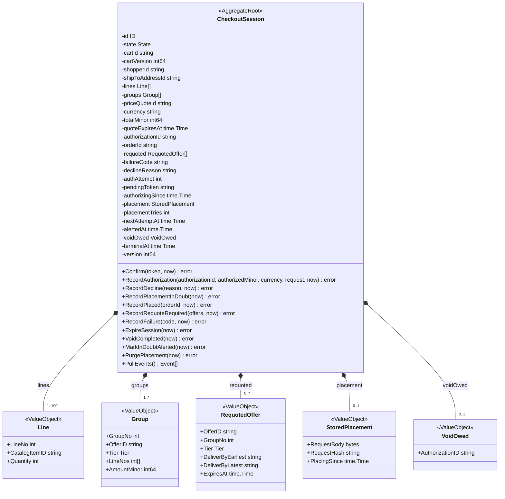
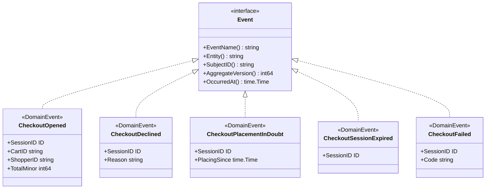
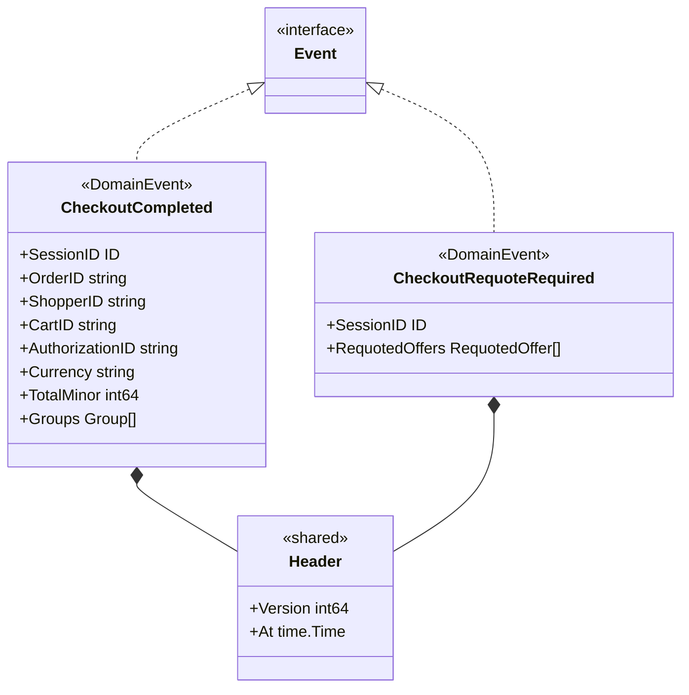
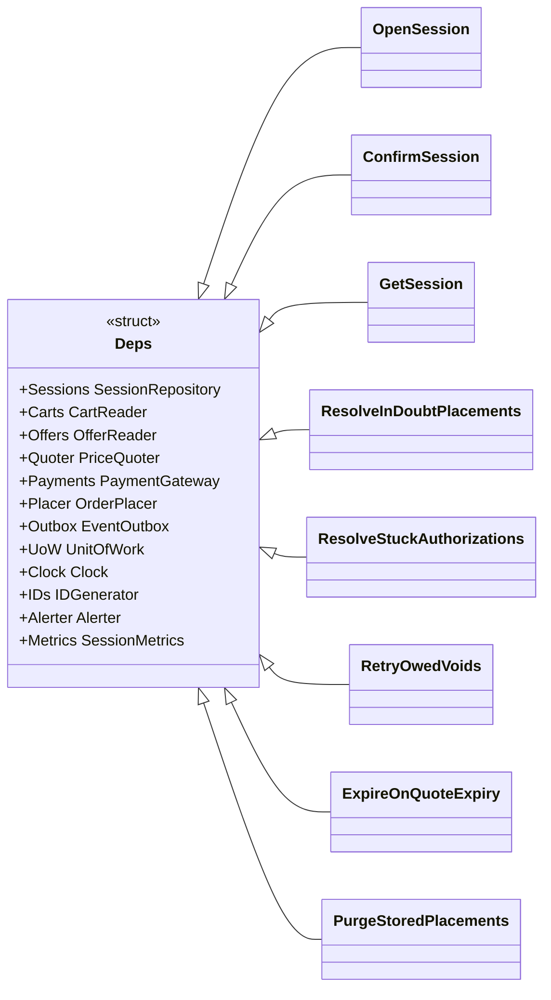
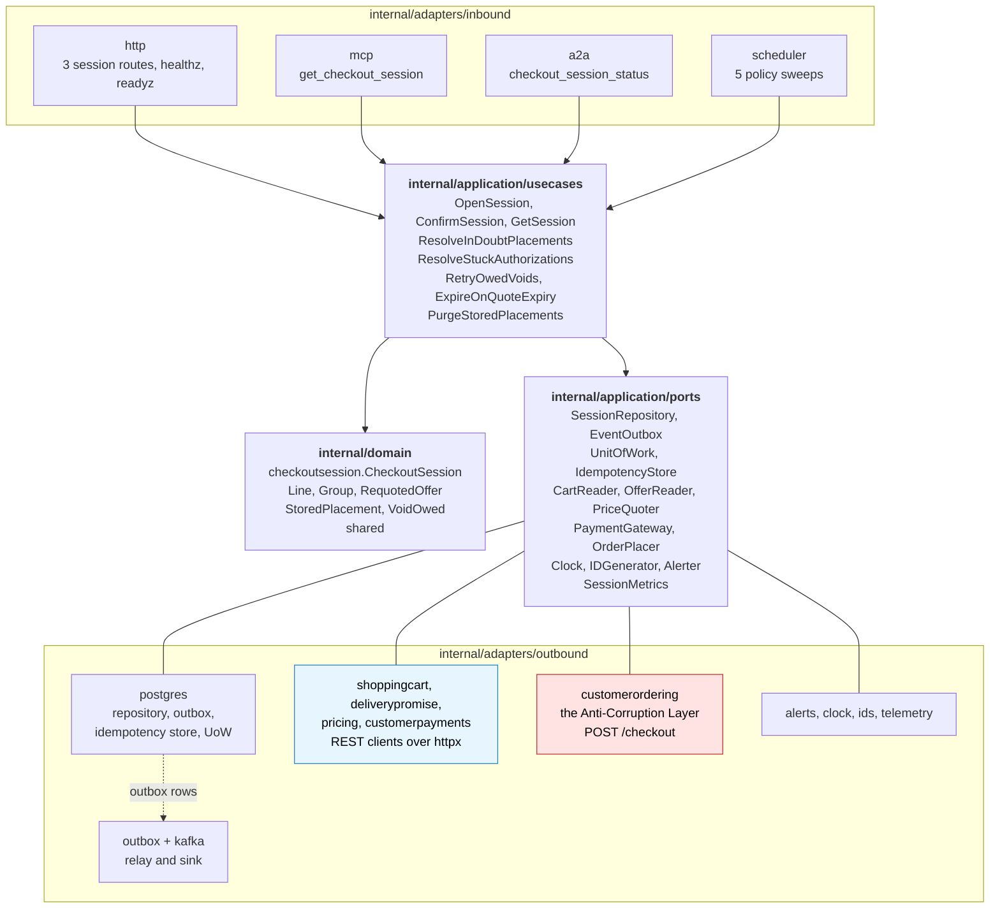

# Class Diagram

UML class diagrams of the Go packages on `develop`: the domain package
`internal/domain/checkoutsession` (with `internal/domain/shared`), the ports of
`internal/application/ports` and the adapters. Fields are unexported in Go and
shown with `-`; methods are shown with `+`. The names are the built
identifiers; the [Ubiquitous Language](/docs/ddd/ubiquitous-language) page maps
each business term to its identifier.

## 1. The CheckoutSession aggregate

Source: `internal/domain/checkoutsession/aggregate.go` (the fields),
`transitions.go` and `terminals.go` (the commands), `values.go` (the value
objects), `open.go` (`Open`, the factory function that returns an `OPEN`
session).

`State` is the string enumeration of the eight states `OPEN`, `AUTHORIZING`,
`DECLINED`, `PLACING`, `REQUOTE_REQUIRED`, `COMPLETED`, `EXPIRED` and `FAILED`;
`Tier` is `SAME_DAY`, `NEXT_DAY`, `TWO_DAY` or `STANDARD`, re-declared locally
(`session.go`): there is no shared kernel with `delivery-promise`.
`RequotedOffer` carries its delivery bounds as `YYYY-MM-DD` strings. The
`pendingToken` is kept only while `AUTHORIZING`. Bounds: at most 100 lines
(`MaxLines`), quantity 1 to 99 (`MaxQuantity`). The domain errors
(`ErrCartNotCheckoutReady`, `ErrPriceQuoteExpired`, `ErrSessionClosed`,
`ErrAuthorizationMismatch`, `ErrPlacementInDoubt`, `ErrOfferNotQuotable`,
`ErrVoidPending`, `ErrContractViolation`) are variables in `session.go`, listed
on the [Aggregate Design Canvas](/docs/ddd/aggregate-design-canvas).

## 2. Events

Source: `internal/domain/checkoutsession/events.go` (`CheckoutOpened`,
`CheckoutDeclined`, `CheckoutPlacementInDoubt`, `CheckoutSessionExpired`,
`CheckoutFailed`), `internal/domain/shared/shared.go` (`Event`).

Source: `internal/domain/checkoutsession/events.go`,
`internal/domain/shared/shared.go` (`Event`, `Header`). Every event embeds
`shared.Header` (the aggregate version and the instant). The wire payloads
(`internal/adapters/outbound/kafka/payloads.go`) are camelCase and are
described on [Domain Events](/docs/ddd/domain-events).

## 3. Application layer: use cases and ports

Source: `internal/application/usecases/deps.go` (the `Deps` bundle each use case
embeds), `open_session.go`, `confirm_session.go`, `queries.go`, `policies.go`,
`resolve_in_doubt.go`. `internal/application/ports` declares the interfaces
only (a fitness test enforces it): `SessionRepository`, `EventOutbox`,
`UnitOfWork`, `IdempotencyStore`, `Clock`, `IDGenerator`, `Alerter`,
`SessionMetrics` in `ports.go`; `CartReader`, `OfferReader`, `PriceQuoter`,
`PaymentGateway` and `OrderPlacer` (the Anti-Corruption Layer port) in
`gateways.go`.

## 4. Hexagonal ports and adapters

Source: `cmd/api/adapters.go` (the wiring of the five gateways and the
Postgres adapters), `cmd/api/workers.go` (the relay and the five schedulers),
`cmd/mcp/main.go`, `cmd/a2a/main.go`, `internal/architecture/architecture_test.go`
(`TestHexagonalArchitecture`).

There is **no inbound Kafka consumer** and no inbox: the service consumes no
topic. There are **five outbound REST clients**: four plain clients and the
`customerordering` adapter, the Anti-Corruption Layer and the only place that
knows the network's wire names. `GetSession` is a real use case: the REST,
MCP and A2A adapters all call it. `cmd/mcp` and `cmd/a2a` wire only the read
repository. The `memory` and `repocontract` packages under
`internal/adapters/outbound` are test fixtures and a contract suite; the
runtime binaries must not import them
(`TestRuntimeBinaryHasNoInMemoryAdapters`).
