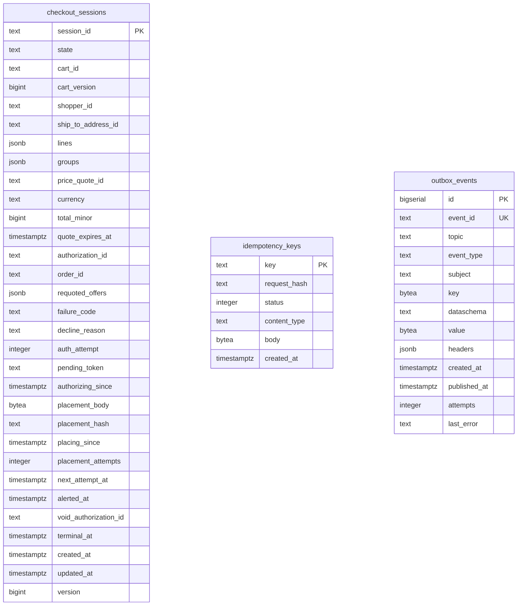

# Entity Relationship

The schema is [`0001_checkout_schema.up.sql`](https://github.com/IQVO/checkout/blob/develop/internal/adapters/outbound/postgres/migrations/0001_checkout_schema.up.sql) plus `0002_idempotency_key_global.up.sql` (the `Idempotency-Key` alone becomes the primary key of `idempotency_keys`), applied at boot by `cmd/api` with golang-migrate (which adds its own `schema_migrations` table; `MIGRATIONS_DATABASE_URL` overrides the connection used for it). Checkout owns its database and shares no table with another context.

Three tables. Key markers: PK primary key, UK unique. Types are the column types of the migration; constraints (CHECK, defaults, partial indexes) are in the file. There is no foreign key: the aggregate is one row, and the infrastructure tables are keyed by their own ids.

Source: `internal/adapters/outbound/postgres/migrations/0001_checkout_schema.up.sql` and `0002_idempotency_key_global.up.sql`.

## Tables

| Table | Columns | Primary key | Role |
| --- | --- | --- | --- |
| `checkout_sessions` | 31 | `session_id` | the `CheckoutSession` aggregate, one row per session |
| `idempotency_keys` | 6 | `key` | stored REST answers per `Idempotency-Key` (global to the service; the row keeps the request fingerprint) |
| `outbox_events` | 13 | `id` | transactional outbox the relay publishes to Kafka |

## How the aggregate maps onto `checkout_sessions`

The `CheckoutSession` aggregate is one row, saved conditional on `version`
(optimistic concurrency, `ErrConcurrentUpdate` on a mismatch). The collections
that belong to the aggregate are `jsonb` columns, not child tables: `lines`,
`groups` and `requoted_offers` (`session_json.go`). The stored placement request
is the three columns `placement_body`, `placement_hash` and `placing_since`; the
owed void is `void_authorization_id`; the PSP token is `pending_token`, set only
while the state is `AUTHORIZING`. `placement_attempts`, `next_attempt_at` and
`alerted_at` drive `ResolveInDoubtPlacements`. The migration adds CHECK
constraints on `state` (the eight values), `currency` (3 characters),
`total_minor` (not negative), `cart_version` and `version` (at least 1) and
`auth_attempt` (not negative); the invariants proper are enforced by the
aggregate in `internal/domain` before a row is written.

## Indexes

Each policy scan has a partial index, so a sweep reads only the rows it needs.

| Index | Columns | Predicate | Used by |
| --- | --- | --- | --- |
| `checkout_sessions_authorizing_idx` | `authorizing_since` | `state = 'AUTHORIZING'` | `ResolveStuckAuthorizations` |
| `checkout_sessions_placing_idx` | `next_attempt_at` | `state = 'PLACING'` | `ResolveInDoubtPlacements` |
| `checkout_sessions_expiry_idx` | `quote_expires_at` | `state IN ('OPEN','DECLINED')` | `ExpireOnQuoteExpiry` |
| `checkout_sessions_void_idx` | `updated_at` | `void_authorization_id IS NOT NULL` | `RetryOwedVoids` |
| `checkout_sessions_purge_idx` | `terminal_at` | `placement_body IS NOT NULL AND terminal_at IS NOT NULL` | `PurgeStoredPlacements` |
| `idempotency_keys_created_idx` | `created_at` | none | expiry of stored answers |
| `outbox_events_unpublished_idx` | `id` | `published_at IS NULL` | the outbox relay |

The `down` migration drops the three tables
(`0001_checkout_schema.down.sql`).
