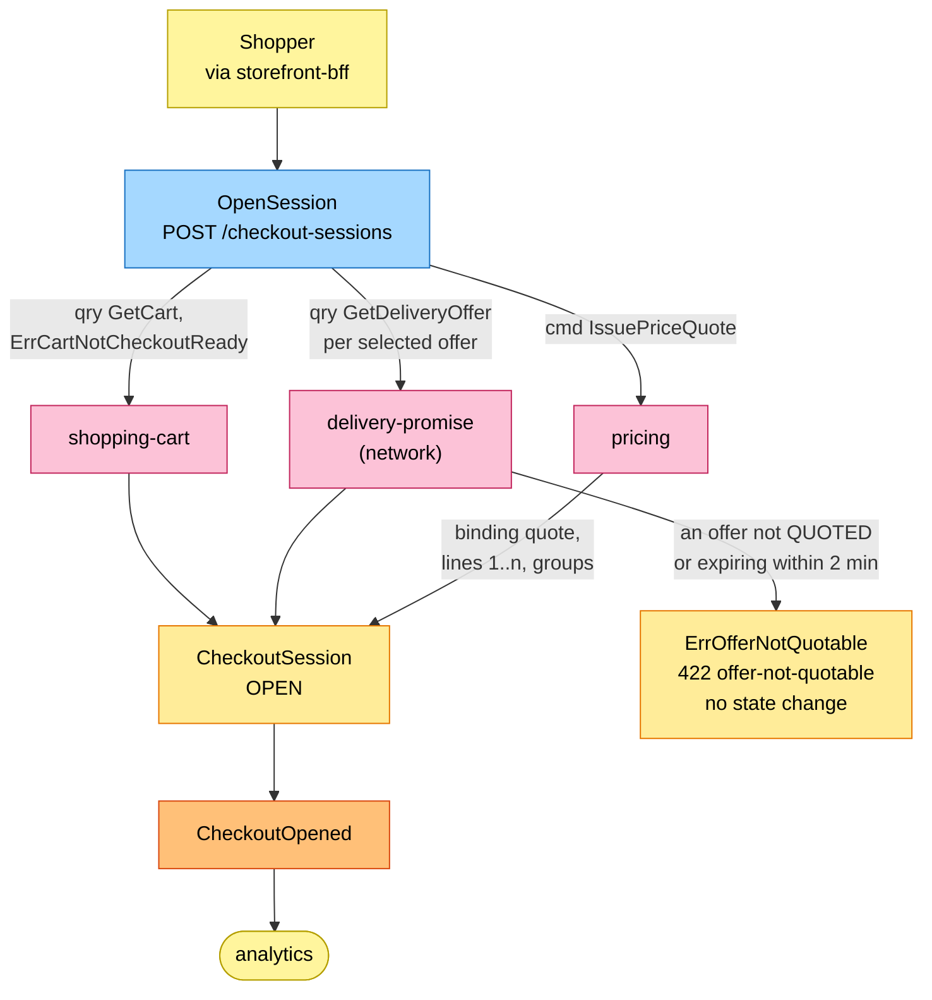
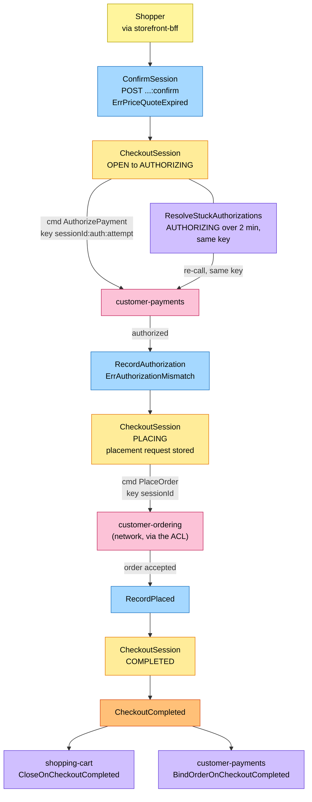
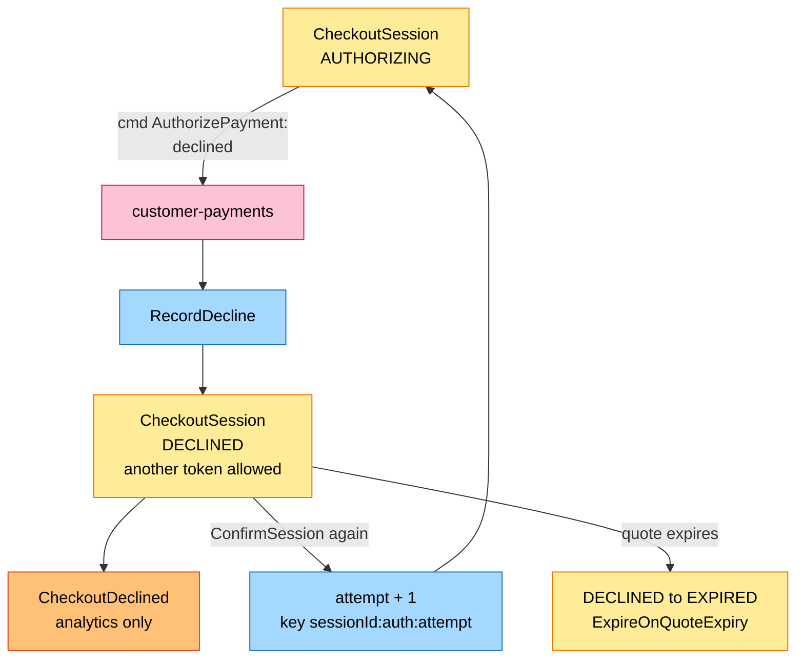
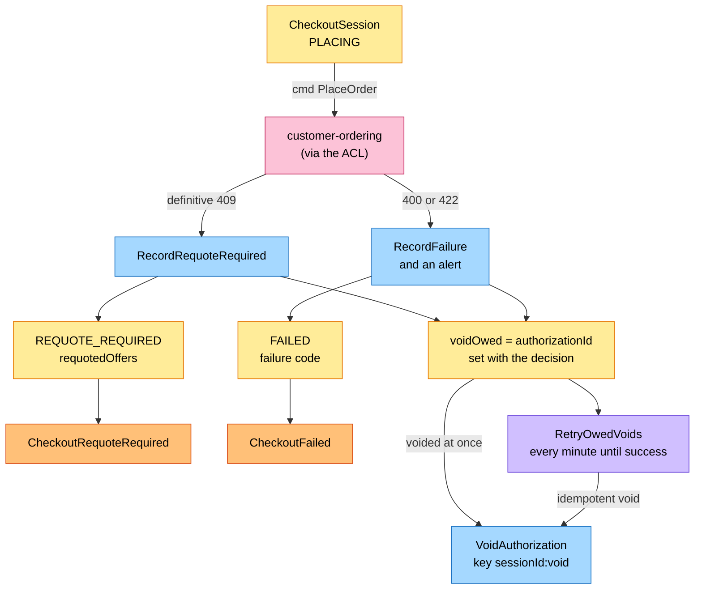
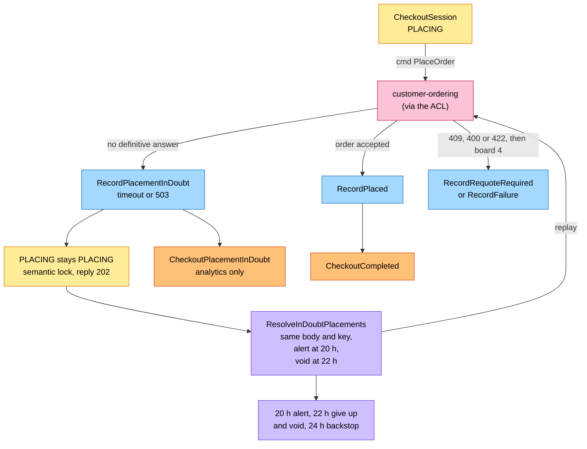
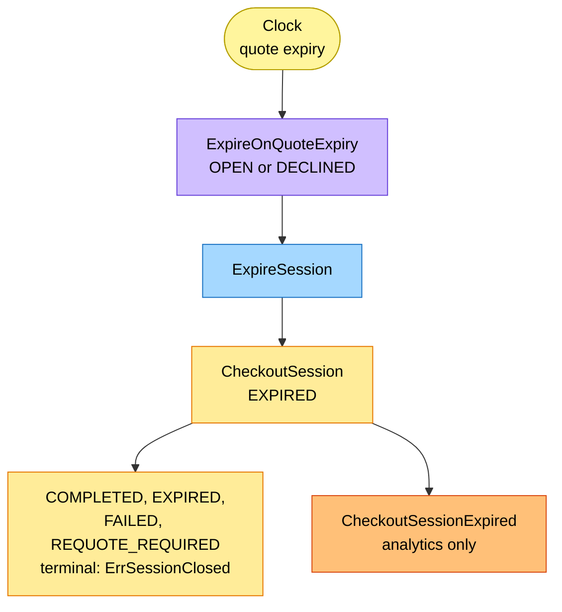

# EventStorming

Process-level boards in the ddd-crew
[EventStorming glossary & cheat sheet](https://github.com/ddd-crew/eventstorming-glossary-cheat-sheet)
notation. Every sticky was checked against the aggregate in `internal/domain/checkoutsession` and
the use cases in `internal/application/usecases`; each board ends with a
`Source:` line. Events published by a neighbour are drawn as orange stickies
prefixed with the producer. Every hotspot is a design-time question, and the
hotspot table says how the code settled it. Boards are drawn top to bottom;
each stays within the page width.

## Legend

| Colour | Sticky | Meaning here |
| --- | --- | --- |
| Pale yellow `#fff59d` | Actor | The shopper (through the BFF), the clock |
| Blue `#a5d8ff` | Command | A command of the `CheckoutSession` aggregate (`internal/domain/checkoutsession/transitions.go`, `terminals.go`) |
| Yellow `#ffec99` | Aggregate | The `CheckoutSession` aggregate and its state |
| Orange `#ffc078` | Domain Event | One of our seven (`internal/domain/checkoutsession/events.go`) or a neighbour's (prefixed with the producer) |
| Lilac `#d0bfff` | Policy | One of the five saga policies (`internal/application/usecases`), or the reaction a neighbour takes to an event |
| Pink `#fcc2d7` | External System | A sibling context or the network (`shopping-cart`, `pricing`, `customer-payments`, `delivery-promise`, `customer-ordering`, analytics) |
| Red `#ff8787` | Hotspot | A design-time question and how the code settled it (see the table at the end) |

## 1. Opening a session

Source: `internal/application/usecases/open_session.go` (`GetCart`,
`GetOffer`, `IssueQuote`), `internal/domain/checkoutsession/open.go`
(`ErrCartNotCheckoutReady`, `ErrOfferNotQuotable`, `CheckoutOpened`). The
storefront gaps S1 and S2 are on the
[Model Gap Register](https://iqvo.github.io/warehouse-docs/storefront/strategic-design/model-gap-register).

The `GetDeliveryOffer` check runs once, at open. An offer that is not `QUOTED`,
or expires within 2 minutes, fails with `ErrOfferNotQuotable`
(`422 offer-not-quotable`), changes no state, and the BFF refreshes the cart
quote. The code does not repeat the check at confirm: an offer that expires
between open and confirm comes back from customer-ordering as a
`PLACING`-time `409`, which is the only way to reach `REQUOTE_REQUIRED`.

Omitted: the `503` when a dependency is unreachable, and the outbox. The
price quote is binding and expiring; its expiry becomes the session's
`quoteExpiresAt`, the clock for board 6.

## 2. Authorize, then place the order

Source: `internal/domain/checkoutsession/transitions.go` and `terminals.go`
(`Confirm`, `RecordAuthorization`, `RecordPlaced`),
`internal/application/usecases/confirm_session.go` (`Authorize` then `Place`),
`policies.go` (`ResolveStuckAuthorizations`) and the `CheckoutCompleted`
consumers named on [Integration](/docs/ecosystem/integration).

`ResolveStuckAuthorizations` settles an unknown authorize outcome: a session
in `AUTHORIZING` for more than 2 minutes re-calls `AuthorizePayment` with the
same key `<sessionId>:auth:<attempt>`, which is idempotent and yields the
true outcome; `customer-payments`' 24 h void stays the backstop.

Omitted: the failure paths (boards 3 and 4), the in-doubt branch (board 5) and
the outbox. The money flow (D5) continues outside this context: capture on
`FulfillmentShipped`, release on `FulfillmentCancelled`, refund on
`PackageLost` or `PackageReturned` all belong to `customer-payments`.

## 3. A decline

Source: `internal/domain/checkoutsession/transitions.go` (`RecordDecline`,
`Confirm` from `DECLINED`), `internal/adapters/outbound/customerpayments/gateway.go`
(what counts as a decline).

A decline voids nothing: no authorization exists. The session stays open for
as long as the price quote is valid; `DECLINED → EXPIRED` is a
transition (`ExpireSession`). Each `DECLINED → AUTHORIZING` increments the
session's attempt counter (it starts at 0), so a retry with another token is a new attempt
under a new key `<sessionId>:auth:<attempt>` and is never answered with the
first, declined response, while a stuck call replays the same key.

## 4. Requote and contract failure

Source: `internal/domain/checkoutsession/terminals.go`
(`RecordRequoteRequired`, `RecordFailure`), `internal/application/usecases/settle.go`
(`settlePlacement`, `settleVoid`), `policies.go` (`RetryOwedVoids`),
`internal/adapters/outbound/customerordering/gateway.go` (the 409, 400 and 422
mapping), `internal/adapters/outbound/customerpayments/gateway.go` (`Void`).

Every definitive rejection (a definitive `409`, a `400` or `422`, and an `ErrAuthorizationMismatch`)
sets the session's owed void (the `authorizationId`, column `void_authorization_id`) in the same
transaction as the decision to void, so no void is lost. The void is attempted
at once; if it fails, `RetryOwedVoids` runs every minute until it succeeds
(`Void` is idempotent, key `<sessionId>:void`). Both events are
analytics-only. Omitted: the shopper's next attempt after `REQUOTE_REQUIRED`,
which starts from the cart with a new session (hotspot H10 on how the cart
takes the requoted offers).

## 5. In-doubt placement

Source: `internal/application/usecases/resolve_in_doubt.go`,
`internal/domain/checkoutsession/transitions.go` (`RecordPlacementInDoubt`,
`backoff`) and `terminals.go` (`AlertDue`, `GiveUpDue`). The 24 h backstop is
customer-payments' own policy and is not built in this repository.

The lock is a business state: a restart does not release it, and the
resolver runs from the stored request (`StoredPlacement`, with `placingSince`
driving the clock). The timeline is ordered: the alert at 20 h, then
`ResolveInDoubtPlacements` gives up and voids at 22 h, then
`customer-payments`' `VoidUnboundAuthorizations` as the backstop at 24 h. All
before the network's 24 h idempotency window closes. `Void` is idempotent, so
a race between the resolver and the backstop is harmless.
`RecordPlacementInDoubt` raises the analytics-only
`CheckoutPlacementInDoubt`.

## 6. Expiry and terminal states

Source: `internal/application/usecases/policies.go` (`ExpireOnQuoteExpiry`),
`internal/domain/checkoutsession/terminals.go` (`ExpireSession`) and
`session.go` (`State.Closed`).

`ExpireSession` covers `OPEN → EXPIRED` and `DECLINED → EXPIRED` and raises
the analytics-only `CheckoutSessionExpired`. `ErrSessionClosed` covers
`COMPLETED`, `EXPIRED`, `FAILED` and `REQUOTE_REQUIRED`; a
`DECLINED` session is not closed (it retries with another token or expires).

Omitted: the same-shaped `COMPLETED`, `FAILED` and `REQUOTE_REQUIRED`
terminals, drawn on boards 2 and 4. A session in `AUTHORIZING` or `PLACING`
is not touched by this policy: only an `OPEN` or `DECLINED` session expires
with its quote.

## Hotspots

The hotspots are the design-time questions the storefront design raised
(H1 to H10). The table says how the code answers each; the same list with the
bounded-context view is on the
[Bounded Context Canvas](/docs/ddd/bounded-context-canvas#decisions-taken-since-the-design-model-and-what-stays-open).

| # | Hotspot | How the code answers it | Where |
| --- | --- | --- | --- |
| H1 | Where does `DECLINED` go when the quote expires? | Settled: `DECLINED` is not closed. `ExpireSession` accepts `OPEN` and `DECLINED` (policy `ExpireOnQuoteExpiry`); `ErrSessionClosed` covers `COMPLETED`, `EXPIRED`, `FAILED` and `REQUOTE_REQUIRED` only. | `internal/domain/checkoutsession/terminals.go`, `session.go` |
| H2 | What key does a second authorize use? | Settled: `<sessionId>:auth:<attempt>`. The counter starts at 0 and grows by one on each `DECLINED → AUTHORIZING`, so a retry with another token is a new attempt while a stuck call replays the same key. | `transitions.go` (`Confirm`), `usecases/confirm_session.go` |
| H3 | What if an offer is no longer quotable? | Settled at open only: `ErrOfferNotQuotable` (`422 offer-not-quotable`), no state change. There is no second check at confirm; a late expiry surfaces as a definitive `409` from customer-ordering and ends in `REQUOTE_REQUIRED`. | `open.go` (`checkOffers`), `customerordering/gateway.go` |
| H4 | What ends `AUTHORIZING` when the outcome is unknown? | Settled: `ResolveStuckAuthorizations` re-calls `AuthorizePayment` with the same key for a session in `AUTHORIZING` for more than 2 minutes. | `usecases/policies.go`, `transitions.go` (`StuckAuthorizationAfter`) |
| H5 | What does a failed void do? | Settled: the owed void is stored with the decision (a definitive `409`, `400`, `422` or `ErrAuthorizationMismatch`) and `RetryOwedVoids` retries every minute. `Void` is idempotent. | `usecases/settle.go`, `policies.go` |
| H6 | The resolver and the 24 h void race. | Settled: an ordered timeline: alert at 20 h, `ResolveInDoubtPlacements` gives up and voids at 22 h. The customer-payments backstop at 24 h is that service's own policy; a race between the two voids is harmless. | `usecases/resolve_in_doubt.go` |
| H7 | Silent outcomes. | Settled: two analytics-only events, `CheckoutSessionExpired` and `CheckoutPlacementInDoubt`. `Confirm` and `RecordAuthorization` stay eventless; `CheckoutCompleted` covers the outcome. | `events.go` |
| H8 | The network contract (`shipToAddressId`, `offer-not-quotable`, `requotedOffers`). | Settled in the gateway: the place-order body carries `shipToAddressId`, and a definitive `409` carries `requotedOffers`. The wire names stay inside the ACL. | `internal/adapters/outbound/customerordering` |
| H9 | The stored placement request. | Settled: `StoredPlacement{RequestBody, RequestHash, PlacingSince}`, replayed byte for byte, `PlacingSince` drives the 20 h alert, purged 24 h after a closed state. | `transitions.go`, `terminals.go` (`PurgePlacement`) |
| H10 | How does the cart take the requoted offers? | Open. This service only carries `requotedOffers` on the `REQUOTE_REQUIRED` session and in `CheckoutRequoteRequired`. Whether and how the BFF writes them into the cart (shopping-cart `AcceptRequotedOffers`) is outside this repository and not verified here. | `usecases/settle.go` |
