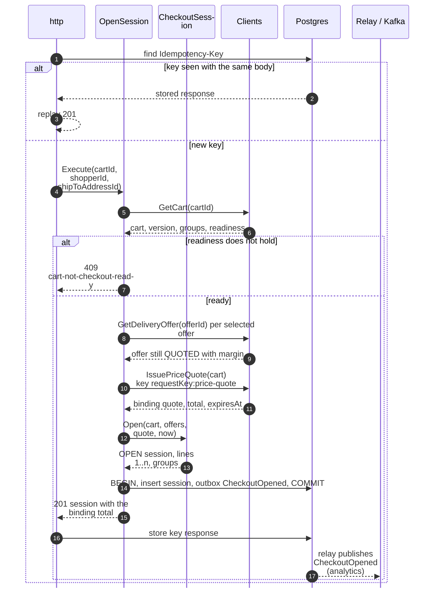
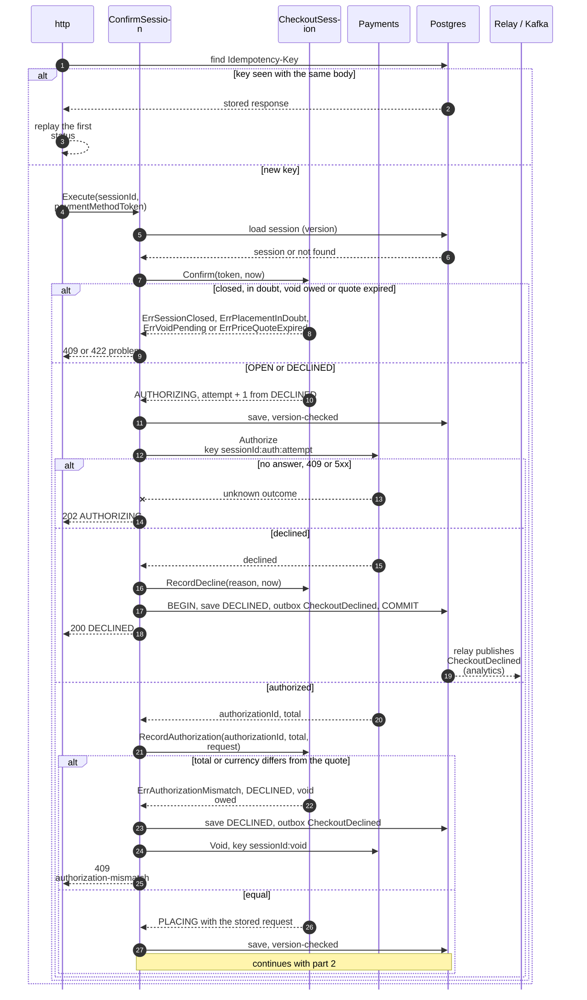
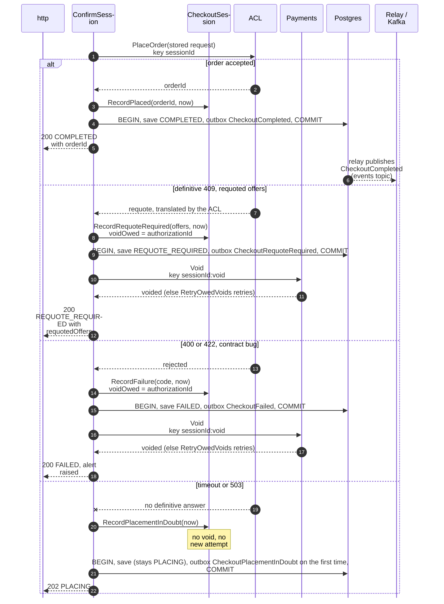
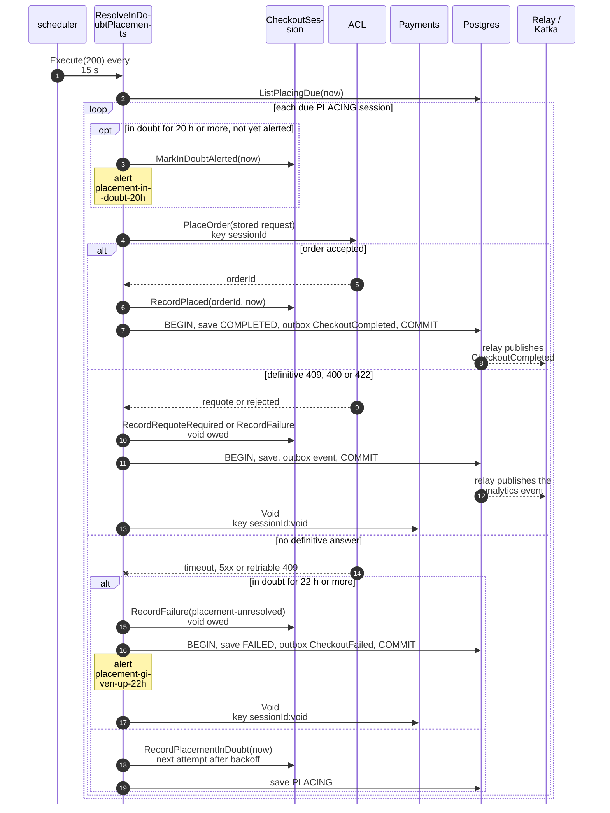
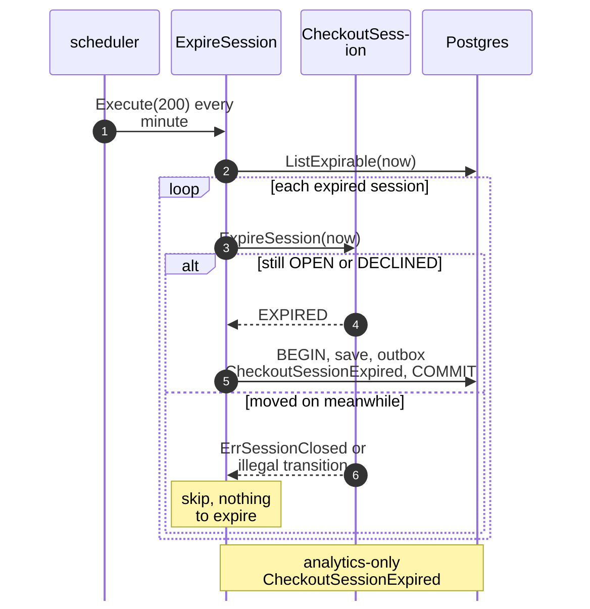

# Sequence Diagrams

One UML sequence diagram per command use case on
[Use Cases](/docs/ddd/use-cases); the long
`ConfirmSession` is drawn in two parts (authorize, then place the order).
Participant names are the packages and ports of the code, from the
[Class Diagram](/docs/ddd/class-diagram):

- `http` and `scheduler` are the inbound adapters.
- The use case is in `internal/application/usecases`.
- `Clients` stands for the outbound REST adapters `shoppingcart`,
  `deliverypromise` and `pricing`; `Payments` for `customerpayments`.
- `ACL` is `internal/adapters/outbound/customerordering`, the
  Anti-Corruption Layer and the only participant that knows the network's wire
  names.
- `Postgres` stands for the repository, the outbox and the idempotency store.
  They share one transaction through `UnitOfWork`.
- `Relay / Kafka` is the outbox relay. It reads committed `outbox_events`
  rows and publishes `CheckoutCompleted` to `retailnetwork.checkout.events`
  and the six other events to `retailnetwork.checkout.analytics`.

Every save is conditional on the loaded `version` (optimistic concurrency; a
conflict re-runs the command once, then answers `409 concurrent-update`).
**No outbound call sits inside a database transaction**: the use case commits
the state it acts from, calls out, then commits the outcome. The
`Idempotency-Key` record is written by the HTTP middleware after the use case
returned, not inside its transaction, and a 5xx is never stored. Full CloudEvents
types are on [Domain Events](/docs/ddd/domain-events).

## 1. OpenSession (REST POST /checkout-sessions)

Source: `internal/adapters/inbound/http/idempotency.go`,
`internal/application/usecases/open_session.go`,
`internal/domain/checkoutsession/open.go` (`Open`, `checkOffers`),
`internal/adapters/outbound/postgres/unit_of_work.go`.

Omitted: the `503` when `Clients` cannot answer (the shopper retries with the
same `Idempotency-Key`), the `422` on invalid input, and the case where an
offer is no longer `QUOTED` at the pre-check, which fails as
`ErrOfferNotQuotable` (`422 offer-not-quotable`, no state change; hotspot H3
on [EventStorming](/docs/ddd/eventstorming)).

## 2. ConfirmSession, part 1: authorize (REST POST .../confirmations)

Source: `internal/application/usecases/confirm_session.go`,
`internal/domain/checkoutsession/transitions.go` (`Confirm`,
`RecordAuthorization`, `RecordDecline`),
`internal/adapters/outbound/customerpayments/gateway.go`.

Omitted: the `404` for an unknown session and the `409 concurrent-update` after a
second version conflict. The offer check is not repeated here: it runs at open
only. A `Payments` timeout on authorize leaves the session `AUTHORIZING` and the
call answers 202; `ResolveStuckAuthorizations` re-calls after 2 minutes with the
same key (hotspot H4). A mismatching total sets the void owed (hotspot H5): the
void is attempted at once and `RetryOwedVoids` repeats it every minute until it
succeeds. A second authorize after a decline is a new attempt with its own key
(hotspot H2).

## 3. ConfirmSession, part 2: place the order

Source: `internal/application/usecases/settle.go` (`settlePlacement`,
`settleVoid`), `internal/adapters/outbound/customerordering/gateway.go` (`Place`),
`internal/domain/checkoutsession/terminals.go` and `transitions.go`.

The stored request is PII-free and carries `shipToAddressId`, never an
address; the `Idempotency-Key` towards the network is the `sessionId`. The
`REQUOTE_REQUIRED` and `FAILED` states are recorded together with
the owed void, in one transaction, before the void is attempted; a failing void
is retried every minute by `RetryOwedVoids` (hotspot H5). Omitted:
the mapping of the network's wire names, which happens inside `ACL`
(`internal/adapters/outbound/customerordering`; hotspot H8).

## 4. ResolveInDoubtPlacements (scheduler)

Source: `internal/application/usecases/resolve_in_doubt.go`,
`settle.go`, `internal/domain/checkoutsession/transitions.go` (`backoff`) and
`terminals.go` (`AlertDue`, `GiveUpDue`), `internal/adapters/inbound/scheduler/scheduler.go`.

The replay is safe because the body is byte for byte the stored one and the
key is the same: customer-ordering is expected to replay its first response. No
shopper waits on this path; the BFF polls `GetSession`. The next attempt of a
session still in doubt is pushed out by a backoff that starts at 30 s and
doubles up to 15 minutes. The timeline is ordered: alert at 20 h, give up and
void at 22 h, customer-payments' own void of an unbound authorization at 24 h as
the backstop (hotspot H6; that policy is not in this repository); `Void` is
idempotent, so a race is harmless.

## 5. ExpireSession (scheduler)

Source: `internal/application/usecases/policies.go` (`ExpireOnQuoteExpiry`),
`internal/domain/checkoutsession/terminals.go` (`ExpireSession`).

`DECLINED` sessions expire like `OPEN` ones (hotspot H1). A session that moves to
`AUTHORIZING` between the load and the call is rejected by the aggregate
(`illegal-transition`) or by the version check, and the sweep skips it.

## Not drawn

`RecordAuthorization`, `RecordDecline`, `RecordPlacementInDoubt`,
`RecordPlaced`, `RecordRequoteRequired` and `RecordFailure` are the steps
drawn inside diagrams 2 to 4; they have no entry point of their own. `GetSession`
(REST `GET /checkout-sessions/{sessionId}`) reads the repository through its
port and changes nothing.