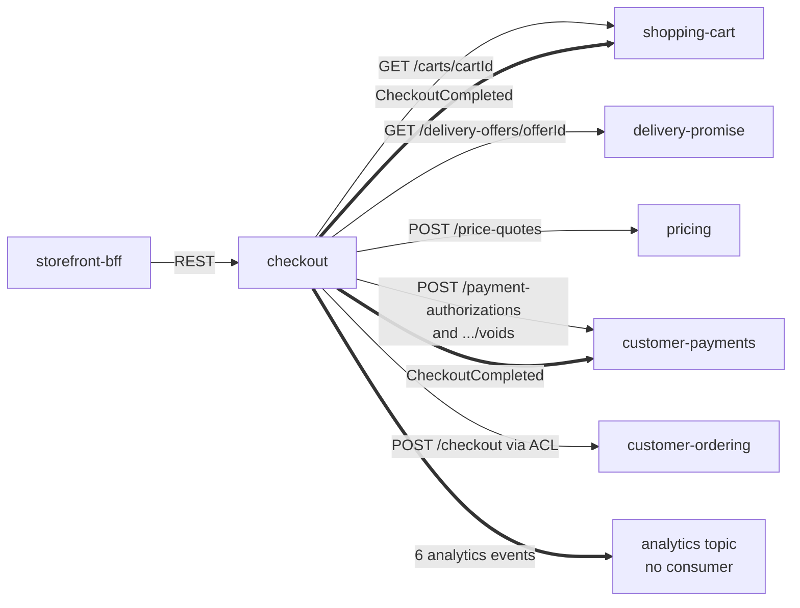

# Integration

Checkout talks to five services synchronously over REST, publishes two Kafka
topics and is read over REST, MCP and A2A. It consumes no topic. As a
storefront context it uses the retail network's Open Host Service routes and
never calls an in-org or restricted network route
([ADR 0003](/docs/adr/0003-synchronous-contracts-and-the-anti-corruption-layer)).
The context map is on [Context map](/docs/ddd/context-map).

Source: `cmd/api/adapters.go` (the five gateways),
`internal/adapters/outbound/kafka/encoder.go` (the two topics).

## Upstream: what checkout calls

Every client is `internal/adapters/outbound/<name>` over the shared
`httpx` client (one bounded request, a 1 MiB response cap, `Accept:
application/json, application/problem+json`, and the `Idempotency-Key` when the
call has one). Timeouts: `SIBLING_TIMEOUT` (default 5 s) for four of them,
`CUSTOMER_ORDERING_TIMEOUT` (default 15 s) for the place-order call. There is no
retry inside a call, no circuit breaker and no `traceparent` on these requests;
retrying is the job of the saga policies.

| Sibling | Call | Idempotency-Key | Failure behaviour in checkout |
| --- | --- | --- | --- |
| **shopping-cart** | `GET /carts/{cartId}`: cart state, destination postal prefix, lines, delivery quote groups with their offers, selections, `checkoutReadiness`, `version` | none | 404 is `validation-failed` (422); any other non-2xx, a timeout or an undecodable body is `shopping-cart-unavailable` (503) and nothing is stored. The cart is ready only when its own readiness is true AND its state is `OPEN`. |
| **delivery-promise** (network OHS) | `GET /delivery-offers/{offerId}` for each selected offer: `state` and `expiresAt` | none | 404 means "not quotable" (`offer-not-quotable`, 422); other failures are `delivery-promise-unavailable` (503). Used only at open (decision H3); a failure changes no state. |
| **pricing** | `POST /price-quotes` with the cart id, destination prefix, numbered lines and groups (`groupNo`, `offerId`, `tier`, `lineNos`) | `<Idempotency-Key>:price-quote` | 4xx is `price-quote-rejected` (422); transport error, timeout, 5xx or an undecodable body is `pricing-unavailable` (503). The same open retried gets the same quote. |
| **customer-payments** | `POST /payment-authorizations` (session id, token, currency, total, allocations per group); `POST /payment-authorizations/{id}/voids` | `<sessionId>:auth:<attempt>`; `<sessionId>:void` | Authorize: 201 `AUTHORIZED` is an authorization; 201 with any other state, or a 422, is a decline; transport error, timeout, 409 or 5xx leave the session `AUTHORIZING` for `ResolveStuckAuthorizations`. Void: 200, 404 and a 409 `illegal-transition` count as done; anything else leaves the debt on the session for `RetryOwedVoids`. |
| **customer-ordering** (network OHS, behind the ACL) | `POST /checkout` with `shopperId`, `shipToAddressId`, numbered lines and the groups' `{groupNo, offerId, lineNos}` | the sessionId | See the table below. The body is rendered once, stored on the session and replayed byte for byte. |

### Place-order outcome mapping

| customer-ordering answers | Meaning for the saga |
| --- | --- |
| 2xx with an `orderId` | placed: `COMPLETED` |
| 409 whose problem type is `offer-not-quotable`, `promise-capacity-exhausted` or `book-closed` | definitive requote: the re-quoted offers become `requotedOffers`, `REQUOTE_REQUIRED`, the authorization is voided |
| 400 or 422 | a contract bug on this side: `FAILED` (`place-order-rejected`), voided, alert |
| anything else: transport error, timeout, 5xx, a `concurrent-update` 409, a 2xx without an `orderId` | outcome UNKNOWN: the session stays `PLACING` (HTTP 202) and `ResolveInDoubtPlacements` replays |

The re-quoted offers carry an optional IANA `timeZone`; each delivery-by bound is
formatted as a calendar date in that zone (UTC when it is absent, `Local` or
unknown, with a one-time WARN), per
[ADR 0008](/docs/adr/0008-requoted-dates-in-the-destination-time-zone).

## Downstream: who uses checkout

| Consumer | How | Contract | Behaviour |
| --- | --- | --- | --- |
| **storefront-bff** (experience layer) | REST under the gateway route `/api/checkout` (warehouse-infra `helm-values/storefront-bff.yaml` sets `checkoutUrl` to `http://checkout.warehouse-systems.svc.cluster.local:80`) | `apis/openapi.yaml` | mints the `Idempotency-Key`, shows the binding total, polls a `PLACING` session. Checkout does not know the BFF; nothing in this repository names it. |
| **shopping-cart** | Kafka `retailnetwork.checkout.events`, event `CheckoutCompleted` | `apis/asyncapi.yaml` | closes the cart. In warehouse-infra it has `checkoutConsumerGroup: shopping-cart-checkout`. |
| **customer-payments** | Kafka `retailnetwork.checkout.events`, event `CheckoutCompleted` | `apis/asyncapi.yaml` | binds the order to the authorization and the per-group allocations. In warehouse-infra it has `checkoutConsumerGroup: customer-payments-checkout`. |
| analytics (none today) | Kafka `retailnetwork.checkout.analytics` | `apis/asyncapi.yaml` | no consumer is wired; the six events are available for funnel analysis. |
| AI clients | MCP, `cmd/mcp`, gateway `/api/mcp/checkout` | [MCP tools](/docs/mcp/tools) | read-only; the local cluster leaves the component off. |
| agents | A2A, `cmd/a2a`, gateway `/api/a2a/checkout` | the Agent Card | read-only; the local cluster enables the component and its route. |

### Event delivery guarantees

- Events are written to `outbox_events` in the same transaction as the session
  change and relayed by an always-on relay: **at-least-once**, one aggregate
  per partition in order (the key is the sessionId).
- The CloudEvents `id` is minted once per occurrence and persisted with the
  row, so a redelivery carries the same `id`: consumers de-duplicate on it.
- `CheckoutCompleted` is on a different topic from the six analytics events, so
  no order is promised across the two topics.
- A breaking payload change is a new `.v2` type, never a mutation
  ([ADR 0004](/docs/adr/0004-cloudevents-envelope-and-type-catalogue)).

## Edges that do not exist

- **No consumer.** Checkout consumes no topic: no consumer group, no DLQ, no
  processed-event table. It learns every outcome from the synchronous answer of
  the call it just made, and an idempotent replay turns an unknown answer into a
  known one.
- **No `warehouse.*` topic.** Checkout never produces or consumes a WES or WMS
  topic.
- **The network never depends on the storefront.** No network context calls a
  checkout route or consumes a checkout topic.
- **No outbound MCP or A2A client.** A2A carries delegation only; the A2A
  adapter has no outbound client (`TestA2AAdapterIsReadOnlyAndHasNoOutboundClient`).
- **No shared database and no shared Go package** with any sibling: each
  gateway restates the one or two routes it uses with its own DTOs.
- **No authentication** on REST, MCP or A2A, in either direction (fleet-wide
  decision); the gateway and the cluster boundary are the only controls.
- **No spans across the sibling calls** (see [Observability](/docs/operations/observability#traces)).
