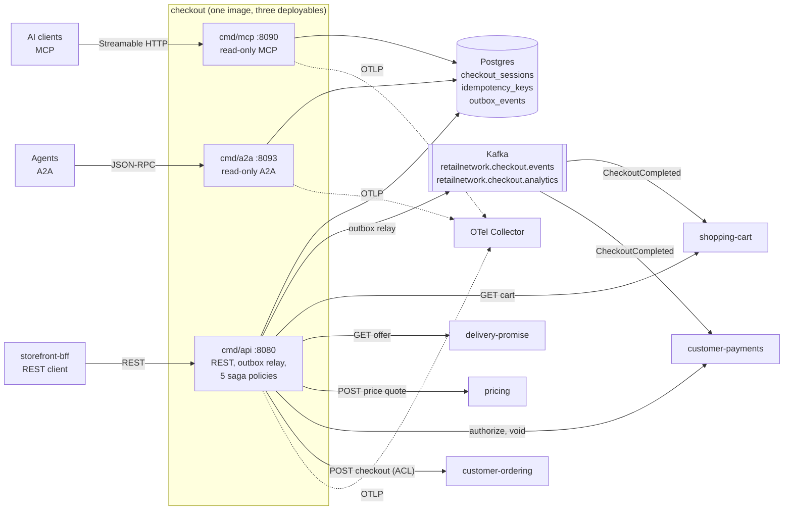

# Architecture

Checkout is a hexagonal (ports and adapters) Go module. Dependencies point
**inward only**: adapters depend on the application layer, the application
layer on the domain, and the domain on nothing but the standard library. The
rule is an executable test, not a convention (`TestHexagonalArchitecture`,
arch-go, in `internal/architecture/architecture_test.go`).

## Layout

```text
cmd/
  api/    composition root: REST, outbox relay, the five saga policies
  mcp/    composition root: read-only MCP server
  a2a/    composition root: read-only A2A agent
internal/
  domain/
    checkoutsession/   the aggregate: states, transitions, events, allocation
    shared/            ids, validation helpers, the Event interface, errors
  application/
    usecases/          one struct per use case: OpenSession, ConfirmSession, GetSession,
                       and the policies ResolveInDoubtPlacements, ResolveStuckAuthorizations,
                       RetryOwedVoids, ExpireOnQuoteExpiry, PurgeStoredPlacements
    ports/             OUT interfaces only: repositories, gateways, EventOutbox, UnitOfWork,
                       IdempotencyStore, Clock, IDGenerator, Alerter, SessionMetrics
    exchange/          the saga's exchange types (cart, quote request, authorization, place outcome)
    idempotency/       the idempotency record and its 24 h TTL
    outbox/            the outbox message and encoder contract
    views/             the read view of a session
  adapters/
    inbound/           http (chi), mcp, a2a, requestlog, scheduler
    outbound/          postgres (+pgtx), kafka, outbox (relay), telemetry, httpx, clock, ids, alerts,
                       and the five sibling clients shoppingcart, pricing, customerpayments,
                       customerordering (the ACL), deliverypromise; memory and repocontract (test support)
    kafka/cloudevents/ the CloudEvents 1.0 envelope (the only place that builds one)
  architecture/        the fitness tests
  bootretry/           bounded retry of the first Postgres dial and the migrations
  bdd/                 godog wiring for features/
features/              Gherkin scenarios
apis/                  openapi.yaml, asyncapi.yaml
charts/checkout/       Helm chart
```

Rules enforced by `internal/architecture`: the domain imports no outer layer;
an adapter does not reach sideways into a sibling adapter; `cmd/**` never
imports the in-memory adapters; the MCP and A2A adapters depend inward only and
nothing depends on them; the A2A adapter is read-only and has no outbound A2A
client; no auth middleware is reintroduced; no `*.go` file sits at the repo
root. See [Testing](/docs/development/testing#fitness-tests-internalarchitecture).

## Binaries

| Binary | Role | Listens on | Reads | Writes |
| --- | --- | --- | --- | --- |
| `cmd/api` | REST API, transactional-outbox relay, five saga policies | `:8080` (`HTTP_ADDR`) | Postgres; shopping-cart, delivery-promise, pricing (REST) | Postgres; Kafka (relay); customer-payments and customer-ordering (REST) |
| `cmd/mcp` | read-only MCP server over Streamable HTTP: tool `get_checkout_session` | `:8090` (`MCP_ADDR`): `/mcp`, `/`, `GET /healthz` | Postgres | nothing |
| `cmd/a2a` | read-only A2A agent, JSON-RPC 2.0: skill `checkout_session_status` | `:8093` (`A2A_ADDR`): `/` and `/a2a`, `/.well-known/agent-card.json`, `GET /healthz` | Postgres | nothing |

`cmd/mcp` and `cmd/a2a` are second and third driving adapters over the SAME
`GetSession` use case. They are wired from `NewDeps(sessionRepository)` and
never name the shared `usecases.Deps` bundle, so no outbox, unit of work,
publisher or sibling gateway is reachable from them: they cannot write, never
start the relay or a policy, never dial Kafka and never call a sibling. They
run the idempotent embedded migrations at boot because they share the
service database. Edge: the Kong gateway exposes the API under `/api/checkout`
(`:8000` on the local cluster), MCP under `/api/mcp/checkout` and A2A under
`/api/a2a/checkout`. All three are unauthenticated.

Inside `cmd/api` the composition root (`main.go`, `adapters.go`,
`workers.go`, `config.go`, `telemetry.go`) builds, in order: configuration
(refused at boot), telemetry (before the router, because the HTTP metric
middleware binds the global meter provider at construction), the Postgres
adapters after the migrations, the business counter, the readiness gate, the
HTTP server, the outbox relay and the schedulers. Shutdown is the reverse and
sequential, relay last.

## Container diagram



Source: `cmd/api/main.go`, `cmd/api/adapters.go`, `cmd/api/workers.go`,
`cmd/mcp/main.go`, `cmd/a2a/main.go`, `internal/adapters/outbound/kafka/encoder.go`.
The consumers of `CheckoutCompleted` are named in `apis/asyncapi.yaml`
and wired in the consumers' own configuration (shopping-cart and
customer-payments each have a `checkoutConsumerGroup` in warehouse-infra
`helm-values`); this repository has no consumer.

## Data stores

| Store | Used by | Content |
| --- | --- | --- |
| **Postgres** (database `checkout`, Secret `checkout-db` in the cluster) | all three binaries | table `checkout_sessions` (the aggregate: scalar columns plus `lines`, `groups`, `requoted_offers` as `jsonb`, the stored placement request `placement_body` / `placement_hash`, the owed void, `version` for optimistic concurrency), `idempotency_keys` (key, request hash, stored response), `outbox_events` (the transactional outbox). Two embedded migrations, `0001_checkout_schema` and `0002_idempotency_key_global`. Pool of at most 10 connections, `statement_timeout = 5s`. |
| **Kafka** (one broker platform-wide, `localhost:9092` from the kind cluster) | `cmd/api` only | produces `retailnetwork.checkout.events` and `retailnetwork.checkout.analytics`; consumes nothing |

See the [Entity relationship](/docs/ddd/entity-relationship) page for the
columns. There is no cache, no search index and no object store.

## How a state change is committed

Every state change follows one shape inside ONE `UnitOfWork` (a Postgres
transaction): load the aggregate with its version, call the domain, save it
conditional on that version (`UPDATE ... WHERE version = ?`) and append the
events it raised to `outbox_events`. A version conflict is retried once by the
use case, then surfaces as HTTP 409 `concurrent-update`. A call to a sibling is
never inside the transaction; the relay publishes outbox rows after the commit.
That is why a crash between "state saved" and "answer received" leaves a row a
policy can find (`AUTHORIZING` or `PLACING` with the stored request).
